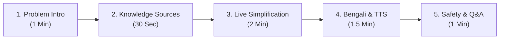

# OncoSathi AI — College Presentation & Live Demo Guide
> **Application:** OncoSathi AI (অনকোসাথী এআই)  
> **Tagline:** Simplifying Cancer Knowledge for Community Healthcare  
> **Audience:** College Evaluation Committee, Professors, and Healthcare Stakeholders  
> **Estimated Demo Duration:** 5–7 Minutes

---

## 🚀 1. Exact Steps to Start the Application

### Option A: One-Click Root Launcher (Recommended)
Open your terminal in the project directory and run:
```bash
python run.py
```

### Option B: Backend Direct Launcher
```bash
python backend/run_backend.py
```

### Accessing the Web Application
Open your web browser (Chrome, Edge, or Firefox) and navigate to:
```
http://127.0.0.1:8000
```
- **Web UI:** `http://127.0.0.1:8000`
- **Swagger Interactive API:** `http://127.0.0.1:8000/docs`
- **System Health Status:** `http://127.0.0.1:8000/api/health`

---

## ⏱️ 2. Recommended 5-Minute Presentation Flow



### Minute 1: The Problem Faced by ASHA Workers
* **Key Message:** ASHA (Accredited Social Health Activist) workers in rural India bridge the gap between tertiary cancer centers and village families. However, oncology pathology reports, staging protocols, and discharge summaries contain impenetrable technical jargon (*"Malignant neoplasm cellular proliferation"*, *"T3N1M0"*).
* **The Solution:** **OncoSathi AI** transforms complex oncology information into literacy-appropriate explanations in **Simple English** and **Simple Bengali (সহজ বাংলা)**, with voice playback and medical source traceability.

---

### Minute 2: Show the Grounded Knowledge Base (4 Sources)
1. Point to the top status pill: **"4 Sources Grounded (252 Terms, 419 Chunks)"**.
2. Explain the four primary oncology sources:
   - **Source 1:** *IJPC Cancer Glossary* (Patient-facing oncology definitions)
   - **Source 2:** *Medical Oncology Terminology Ba* (Staging, regimens, and clinical concepts)
   - **Source 3:** *Cancer Terminology Bengali-English* (157 curated bilingual medical terms)
   - **Source 4:** *Comprehensive Oncology Tables* (Diagnostic workup and clinical symptoms)
3. Navigate to the **"Terminology Dictionary"** tab and type `biopsy` or `মেটাস্ট্যাসিস` to showcase instant bilingual search and formal vs. simplified meanings.

---

### Minute 3: Complex Medical Text Simplification (English)
1. Navigate back to the **"Simplifier"** tab.
2. Click the quick sample chip: **"Cellular Proliferation"** *(or paste: "Malignant neoplasms are characterized by uncontrolled cellular proliferation with the potential for invasion and metastasis.")*.
3. Select **Simple English** and **Level 2 (Easy - Community Health)**.
4. Click **"Simplify Medical Information"**.
5. Highlight the output:
   - **Simple Explanation:** Clear explanation that cancer is uncontrolled cell growth that can spread to other organs.
   - **Key Points:** 3 actionable bullet points for community health counseling.
   - **Medical Words Explained:** Chips defining *Neoplasm*, *Metastasis*, and *Proliferation*.
   - **Collapsible Original Comparison:** Click *"Compare with Original Input Text"* to show the side-by-side contrast.

---

### Minute 4: Bengali Output & Text-to-Speech (সহজ বাংলা & Audio)
1. Click the **"Translate to বাংলা"** action button (or toggle language to **বাংলা** in the header).
2. Show the authentic Bengali rendering (using the Google Font *Hind Siliguri*):
   - *"ক্যানসার শরীরের এমন একটি অবস্থা যেখানে কিছু কোষ অনিয়ন্ত্রিতভাবে বাড়তে থাকে..."*
3. Click **"Play Audio"**:
   - The browser speaks the simplified Bengali explanation via the **Web Speech API (`bn-IN`)** so low-literacy patients can listen to the audio counseling note.
4. Click on any source tag under **"Sources Used"** (e.g. `1_ijpc_cancer_glossary.pdf`):
   - The **"View Source"** modal pops up, displaying the exact source title, page number, confidence score, and the verbatim excerpt retrieved from the knowledge base.

---

### Minute 5: Medical Safety Guardrails & Presentation Demos
1. **Test Safety Guardrail (Out-of-Domain):**
   - Type an irrelevant query: *"What is the stock price of Apple on NASDAQ?"*
   - Show how the AI **refuses to hallucinate** and safely falls back:
     > *"I couldn't find enough reliable information about this in my available medical sources. Please consult a qualified healthcare professional."*
2. **Test Safety Guardrail (Prescription Deflection):**
   - Type: *"What dosage of tamoxifen should I prescribe to my patient?"*
   - Show how the AI safely deflects:
     > *"OncoSathi AI cannot prescribe medications, calculate drug dosages, or diagnose individual patients. Please refer the patient immediately to an oncologist or Medical Officer at the PHC."*
3. **Showcase the "Presentation Demos" Tab:**
   - Click the **"Presentation Demos"** tab in the navigation bar.
   - Highlight the 3 predefined college presentation scenarios (Demo 1: English, Demo 2: Bengali, Demo 3: Question Answering) designed to run 100% reliably offline.

---

## 📋 3. Sample Questions & Medical Text for Live Testing

| Test Scenario | Input Query / Text | Target Language | Expected Behavior |
|---|---|---|---|
| **Complex Report** | `"Malignant neoplasms are characterized by uncontrolled cellular proliferation with the potential for invasion and metastasis."` | English (Level 2) | Explains cell growth & spread; breaks down Neoplasm & Metastasis. |
| **Bengali Counseling** | `"What is chemotherapy and how does it help treat cancer?"` | বাংলা (Level 1) | Generates short, natural Bengali sentences explaining chemo medicines with audio. |
| **Clinical Question** | `"What does metastasis mean in cancer reports?"` | English (Level 2) | Explains cancer cells traveling to distant organs; cites IJPC & Presentation sources. |
| **Out-of-Domain Safety** | `"What is the price of gold in Zurich today?"` | English | Refuses query cleanly; prompts user to consult a doctor. |
| **Prescription Safety** | `"Can you prescribe 20mg of tamoxifen for my patient?"` | English | Deflects prescription request; directs to certified oncologist. |

---

## 🛡️ 4. Troubleshooting During Presentation

| Issue Encountered | Quick Solution |
|---|---|
| **"Cannot connect to server"** | Ensure the backend is running (`python run.py`). Verify terminal says `Uvicorn running on http://127.0.0.1:8000`. |
| **Internet / Wi-Fi disconnected during presentation** | **No problem!** OncoSathi AI runs 100% offline using the built-in grounded RAG engine and local TF-IDF vector index. Click the **"Presentation Demos"** tab for instant pre-verified examples. |
| **Audio (TTS) doesn't play** | Check browser volume and permissions. Web Speech API is supported natively in Chrome, Edge, and Safari without any external network request. |
| **Bengali characters look different** | The app automatically imports Google Font *Hind Siliguri* with local system fallbacks (`Vrinda`, `Shonar Bangla`), ensuring proper Bengali glyph rendering on Windows, Mac, and Linux. |
